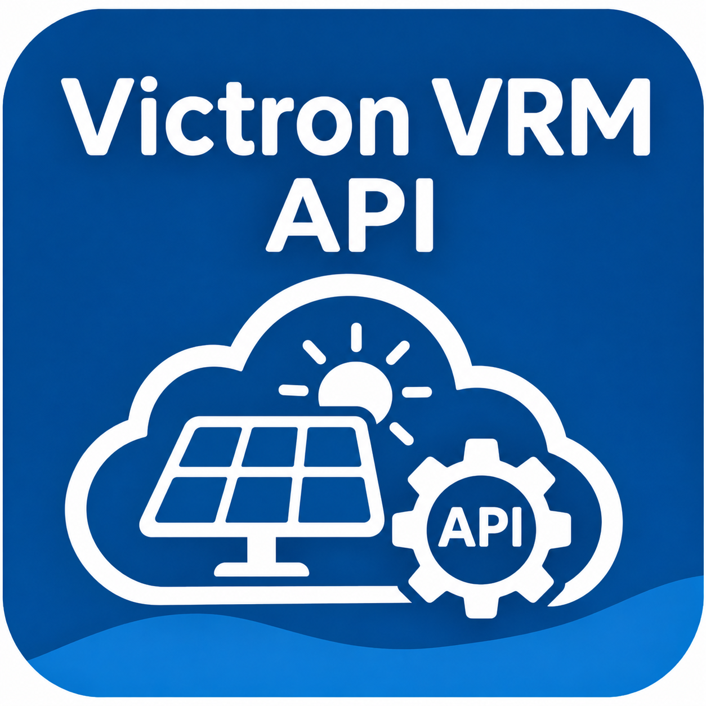

# ioBroker.victron-vrm-api

[](https://www.npmjs.com/package/iobroker.victron-vrm-api)
[](https://www.npmjs.com/package/iobroker.victron-vrm-api)


[](https://nodei.co/npm/iobroker.victron-vrm-api/)

**Tests:** 

## Victron VRM API adapter for ioBroker

This adapter reads the data of your Victron Energy installations from the cloud API of the
[VRM portal](https://vrm.victronenergy.com). You do not need local access to the GX device (Cerbo GX, Venus GX, …):
everything VRM knows about an installation is available as ioBroker states.

The adapter only reads data. It never changes anything on your installations.

Inspired by the Node-RED node [victron-vrm-api](https://github.com/dirkjanfaber/victron-vrm-api) by Dirk-Jan Faber.

### Features

- Supports several installations per VRM account. You can poll all of them or only the ones you select.
- Provides all diagnostics values that VRM reports, with name, unit and role, one folder per device.
- Lists the devices with product name, firmware and last connection. Folders are named after the devices in VRM
  (custom name, product or model), e.g. "Fronius Symo 5.0-3-M (PV Inverter 20)".
- Provides well-known live values with fixed ids (state of charge, PV, grid, consumption, battery).
- Provides energy totals for today, week, month and year: PV yield, consumption, grid import and export,
  battery charged and discharged, plus the individual energy flows (e.g. PV to battery). One request per
  installation.
- Provides the PV yield and consumption forecast for today (total and rest of the day) and tomorrow, plus the
  hourly forecast as JSON.
- Provides the alarms from the VRM alarm log: number and list of active alarms, the newest alarm and the last 25
  entries as JSON.
- Lets you exclude devices and values with simple patterns, and cleans up obsolete objects on request.
- Optionally adds sums over L1–L3 for power, current and energy values.
- Uses the time at which VRM logged each value as the state timestamp, so history adapters (History, InfluxDB,
  SQL) store the real point in time, not the time of the poll.
- Shows whether the data in VRM is still fresh (`info.dataStale`).
- Shows an ioBroker notification in admin when VRM rejects the access token. The notification-manager adapter can
  forward it, e.g. to Telegram or e-mail.
- Answers read-only VRM requests from scripts (`sendTo`), see below.
- Sends requests one after another, honours the VRM rate limit (HTTP 429) and backs off when errors occur.

## Requirements

- Node.js 22 or newer
- js-controller 6.0.11 or newer, admin 7.0.23 or newer
- A VRM account with access to the installations and an access token

## Configuration

1. Create an access token in VRM: **Preferences → Integrations → Access tokens**.
2. Open the instance settings and enter the token on the **Connection** tab.
3. Choose your installations. The list is loaded by the running instance, so save the token first if it stays empty.
   Leave the selection empty to poll all installations of the account.

| Option | Default | Description |
|---|---|---|
| Access token | – | VRM access token. It is stored encrypted. |
| Test connection | – | Button: checks the entered token, also before saving, and shows the user and the installations |
| Installations | all | Installations to poll |
| Live values / diagnostics interval | 1 min | How often the diagnostics are fetched (1–1440 min) |
| Mark data as stale after | 30 min | Sets `info.dataStale` when VRM has received no new data for this time |
| Read energy statistics | on | Energy totals, see below |
| Energy statistics interval | 15 min | How often the energy totals are fetched (1–1440 min) |
| Read forecast | on | Forecast, see below |
| Forecast interval | 60 min | How often the forecast is fetched from VRM (15–1440 min) |
| Read alarms | on | Alarm log, see below |
| Alarms interval | 5 min | How often the alarm log is fetched (1–1440 min) |
| Calculate phase sums | on | Creates totals over L1–L3, see below |
| Exclude devices and values | – | Exclusion list, see below |
| Delete obsolete objects | off | Cleans up the object tree at start, see below |
| Request timeout | 30 s | HTTP timeout per request |

> **How fresh is the data?** The GX device sends its data to VRM at its *log interval*. The default is 15 minutes.
> Polling faster than that brings no new values. For near-live data, set
> **Settings → VRM online portal → Log interval** on the GX device to 1 minute.

## States

```
victron-vrm-api.0
├─ info.connection            connected to the VRM API
├─ info.lastUpdate            last successful poll
├─ info.user.id / .name       VRM account
└─ <idSite>                   one device per installation
   ├─ info.name, .identifier, .timezone
   ├─ info.lastTimestamp      time of the newest data in VRM
   ├─ info.dataStale          true if VRM has had no new data for longer than configured
   ├─ live.*                  well-known values (see below)
   ├─ energy
   │  └─ today | week | month | year
   │     ├─ solarYield, consumption, gridImport, gridExport,
   │     │  batteryCharged, batteryDischarged (genset if present)
   │     └─ flows.*           pvToConsumers, pvToBattery, pvToGrid, gridToConsumers, …
   ├─ forecast              solar…/consumption… Today, RemainingToday, Tomorrow, PowerNow; hourly (JSON)
   ├─ alarms                count, active, activeText, activeList, lastText, lastStarted, lastCleared, history
   ├─ devices
   │  └─ <device>_<instance>  name, deviceType, customName, productName, productCode,
   │                          firmwareVersion, lastConnection, instance
   │                          (gateway also: loggingInterval, lastPowerUpOrRestart; Fronius: model)
   └─ diagnostics
      └─ <device>_<instance>  e.g. battery_monitor_279, ve_bus_system_276, grid_meter_40
         ├─ <code>            one state per VRM data attribute, e.g. "bv", "IP1", "g1p"
         └─ sum.*             totals over L1–L3 (if enabled)
```

The ids of the device folders (`pv_inverter_20`) are stable. The names shown in admin come from VRM, so
renaming a device in VRM does not break scripts or history. The device list is read at start and then every hour.

### Live values

Each value comes from the system overview of the GX device. If that is missing, the adapter falls back to the
individual devices. A state is only created if the installation reports the value.

| State | Unit | Description |
|---|---|---|
| `live.soc` | % | Battery state of charge |
| `live.batteryVoltage` | V | Battery voltage |
| `live.batteryCurrent` | A | Battery current |
| `live.batteryPower` | W | Battery power (positive = charging) |
| `live.pvDcPower` | W | PV power, DC-coupled (solar chargers) |
| `live.pvAcPower` | W | PV power, AC-coupled (PV inverters) |
| `live.pvPower` | W | PV power total |
| `live.gridPower` | W | Grid power, sum of all phases (positive = import) |
| `live.consumption` | W | AC consumption, sum of all phases |

### Energy statistics

The adapter reads the energy flows from VRM (`overallstats`) and adds them up. All values are in kWh, with the
periods as VRM defines them.

| State | Calculation | VRM codes |
|---|---|---|
| `solarYield` | PV to consumers + battery + grid | Pc + Pb + Pg |
| `consumption` | PV + grid + battery + generator to consumers | Pc + Gc + Bc + gc |
| `gridImport` | grid to consumers + battery | Gc + Gb |
| `gridExport` | PV + battery to grid | Pg + Bg |
| `batteryCharged` | PV + grid + generator to battery | Pb + Gb + gb |
| `batteryDischarged` | battery to consumers + grid | Bc + Bg |
| `genset` | generator to consumers + battery (only if present) | gc + gb |

The totals match those shown in VRM (solar yield, consumption, energy from and to the grid). Flows without any
data, e.g. a generator that does not exist, are not created.

### Forecast

VRM calculates hourly forecasts for PV yield and consumption. The adapter provides them per installation. If VRM
also reports heat pump or EV charger forecasts, they appear as `heatPump…` and `evCharger…`.

| State | Unit | Description |
|---|---|---|
| `forecast.solarToday` / `consumptionToday` | kWh | Whole day today |
| `forecast.solarRemainingToday` / `consumptionRemainingToday` | kWh | From now until midnight |
| `forecast.solarTomorrow` / `consumptionTomorrow` | kWh | Whole day tomorrow |
| `forecast.solarPowerNow` / `consumptionPowerNow` | W | Average power expected in the current hour |
| `forecast.hourly` | JSON | `[{"ts": 1793530800000, "solar": 6302, "consumption": 2415}, …]` with Wh per hour for today and tomorrow |

Days are counted in the time zone of the installation. The adapter fetches the forecast from VRM every hour, and
recalculates the rest of today and the current hour from that data every 5 minutes.

### Alarms

The adapter reads the alarm log of each installation (`/installations/{id}/alarm-log`), the same list VRM shows under
**Alarm logs**. Only alarms that VRM monitors appear there. Which ones these are is set in VRM under
**Settings → Alarm rules**.

| State | Type | Description |
|---|---|---|
| `alarms.count` | number | Number of active alarms |
| `alarms.active` | boolean | `true` while at least one alarm is active, good as a trigger |
| `alarms.activeText` | text | Active alarms, e.g. `VE.Bus System: Overload L1 (Warning)`, empty if there are none |
| `alarms.activeList` | JSON | Active alarms as a list (see below) |
| `alarms.lastText` | text | Newest alarm, active or already cleared |
| `alarms.lastStarted` / `lastCleared` | date | Start and end of the newest alarm in ms, `lastCleared` is empty while it is active |
| `alarms.history` | JSON | The last 25 alarms, newest first |

An entry of the JSON lists looks like this:

```json
{"device": "VE.Bus System", "instance": 276, "text": "Low battery (Warning)", "level": "Warning",
 "active": false, "started": 1793453315000, "cleared": 1793453344000}
```

The device is the custom name from VRM if one is set. The alarm log is fetched every 5 minutes by default.
An alarm can only appear once the GX device has sent its data to VRM, see the log interval above.

### Phase sums

For power, current and energy values that a device reports per phase, the adapter creates a total in the `sum`
folder of that device. Examples:

| State | Source values |
|---|---|
| `diagnostics.system_overview_0.sum.Grid` | Grid L1 + L2 + L3 |
| `diagnostics.grid_meter_40.sum.Grid_Energy_from_net` | Grid L1–L3 – Energy from net |
| `diagnostics.ve_bus_system_276.sum.Input_power` | Input power 1 + 2 + 3 |

The adapter detects the phase from the name or the D-Bus path, and the quantity from the name or the unit
(W, A, kWh). A total is created as soon as at least two phases are present. Setpoints, limits and minimum or
maximum values (e.g. `Hub4 power setpoint`, `Max Feedin Power`) get no total, because their sum is not a measured value.
`native.sources` of each sum state lists the codes it was built from.

### Excluding devices and values

A single installation easily reports more than 500 diagnostics values. The exclusion list keeps the object tree
manageable. Enter one pattern per line. `*` matches any text, `?` a single character. Case does not matter, and
lines starting with `#` are comments. Each pattern is compared with:

| Compared with | Example pattern | Excludes |
|---|---|---|
| Device folder | `gateway_0`, `pv_inverter_*` | the whole device |
| Device name from VRM | `MultiPlus*` | the whole device |
| Device folder and value id | `ve_bus_system_276.v*` | single values of one device |
| Name of the value | `*alarm*`, `Phase rotation` | values of all devices with that name |

```
# firmware and VE.Bus details of the Multi
ve_bus_system_276.v*
# alarm and warning flags (the alarm log is in alarms.*)
*alarm*
*warning*
```

The list applies to `diagnostics.*`, the phase sums (e.g. `ve_bus_system_276.sum.*`) and the device list
`devices.*`. The live values are always kept. Values that already exist are only removed when
**Delete obsolete objects** is enabled.

### Deleting obsolete objects

The adapter never deletes objects on its own. With **Delete obsolete objects** enabled, it removes at every start,
after the first successful poll:

- installations that are no longer selected or no longer in the account,
- devices (`devices.*`, `diagnostics.*`) that VRM no longer reports, e.g. after removing them in the VRM device list,
- the `energy`, `forecast` and `alarms` folders when the matching option is disabled,
- the `sum` folders when the phase sums are disabled, and single sums that are no longer calculated,
- devices and values that match the exclusion list.

Each deleted object is logged. Data already stored by History, InfluxDB or SQL is kept, but the settings of the
deleted states (e.g. history logging) are lost. If VRM returns an empty device list, no devices are deleted.

### Requests from scripts

Scripts can read any other VRM data through the adapter with `sendTo`. The token stays in the adapter
configuration, and the request uses the same queue as the adapter, so the VRM rate limit applies to both.

```js
sendTo("victron-vrm-api.0", "get", {
    path: "/installations/123456/stats",
    params: { type: "kwh", interval: "days", start: 1772323200, end: 1774998000 },
}, result => {
    if (result.error) {
        log(`VRM request failed: ${result.error}`, "warn");
    } else {
        log(JSON.stringify(result.data.records));
    }
});
```

| Field | Description |
|---|---|
| `path` | Path of the [VRM API](https://vrm-api-docs.victronenergy.com/), e.g. `/installations/<idSite>/widgets/BatterySummary` |
| `params` | Query parameters as object. Arrays become repeated parameters, e.g. `{ "attributeCodes[]": ["Pc", "Pb"] }` |

The answer is `{ data }` with the complete VRM response, or `{ error, status }` with the HTTP status if VRM
returned one. Only GET requests are possible, and only for paths below the installations the adapter polls
(`/installations/<idSite>/…`) and for the own user (`/users/me`, `/users/<own id>/…`). Scripts may send up to
30 requests per minute.

## Planned

- Dynamic ESS (read only)

## Developer notes

```bash
npm install
npm run build
npm test          # unit tests and package tests
npm run lint
```

### dev-server

```bash
npm run dev-server -- setup --adminPort 8082   # choose another port if 8081 is already in use
npm run dev-server watch
```

All other ports of the dev-server are derived from the admin port.

`watch` compiles changed files, but not newly created ones. After adding a new `.ts` file, run
`npx build-adapter ts` once. Do not use `npm run build` while `watch` is running, because it deletes `build/` first.

Do not start the instance in the dev-server admin. In `watch` mode nodemon runs the adapter itself. If the
instance is enabled as well, both processes collide (`ADAPTER_ALREADY_RUNNING`). To disable the instance, run
the following in `.dev-server/default`:

```bash
node node_modules/iobroker.js-controller/iobroker.js stop victron-vrm-api.0
```

`npm run dev-server` first applies the patches in `patches/` with [patch-package](https://github.com/ds300/patch-package):

- `ps-tree`: reads the process list via PowerShell, because Windows 11 25H2 and later no longer ship `wmic.exe`
  (`spawn wmic.exe ENOENT`).
- `@iobroker/dev-server`: no longer crashes with `ENOENT … .js.map` when `build/` is deleted while `watch` is
  running (e.g. by `npm run build`).

## Disclaimer

Victron Energy and VRM are trademarks of Victron Energy B.V. This project is not affiliated with, endorsed by
or supported by Victron Energy. It uses the public VRM API.

## Changelog
<!--
    Placeholder for the next version (at the beginning of the line):
    ### **WORK IN PROGRESS**
-->
### **WORK IN PROGRESS**
* (IggePop) option to delete obsolete objects (deselected installations, removed devices, disabled options)
* (IggePop) exclusion list for devices and diagnostics values
* (IggePop) no phase sums for setpoints and limits (e.g. Hub4 power setpoint, Max Feedin Power)
* (IggePop) sendTo "get" for own read-only VRM requests from scripts
* (IggePop) button "Test connection" in the instance settings
* (IggePop) ioBroker notification when VRM rejects the access token

### 0.1.0 (2026-11-02)
* (IggePop) initial release
* (IggePop) diagnostics of all installations of a VRM account with well-known live values
* (IggePop) device list with product name and firmware, VRM device names as folder names
* (IggePop) energy statistics for today, week, month and year
* (IggePop) solar yield and consumption forecast
* (IggePop) alarms from the VRM alarm log
* (IggePop) optional sums over L1-L3, VRM timestamps as state timestamps

## License
MIT License

Copyright (c) 2026 IggePop <mail@igge.org>

Permission is hereby granted, free of charge, to any person obtaining a copy
of this software and associated documentation files (the "Software"), to deal
in the Software without restriction, including without limitation the rights
to use, copy, modify, merge, publish, distribute, sublicense, and/or sell
copies of the Software, and to permit persons to whom the Software is
furnished to do so, subject to the following conditions:

The above copyright notice and this permission notice shall be included in all
copies or substantial portions of the Software.

THE SOFTWARE IS PROVIDED "AS IS", WITHOUT WARRANTY OF ANY KIND, EXPRESS OR
IMPLIED, INCLUDING BUT NOT LIMITED TO THE WARRANTIES OF MERCHANTABILITY,
FITNESS FOR A PARTICULAR PURPOSE AND NONINFRINGEMENT. IN NO EVENT SHALL THE
AUTHORS OR COPYRIGHT HOLDERS BE LIABLE FOR ANY CLAIM, DAMAGES OR OTHER
LIABILITY, WHETHER IN AN ACTION OF CONTRACT, TORT OR OTHERWISE, ARISING FROM,
OUT OF OR IN CONNECTION WITH THE SOFTWARE OR THE USE OR OTHER DEALINGS IN THE
SOFTWARE.