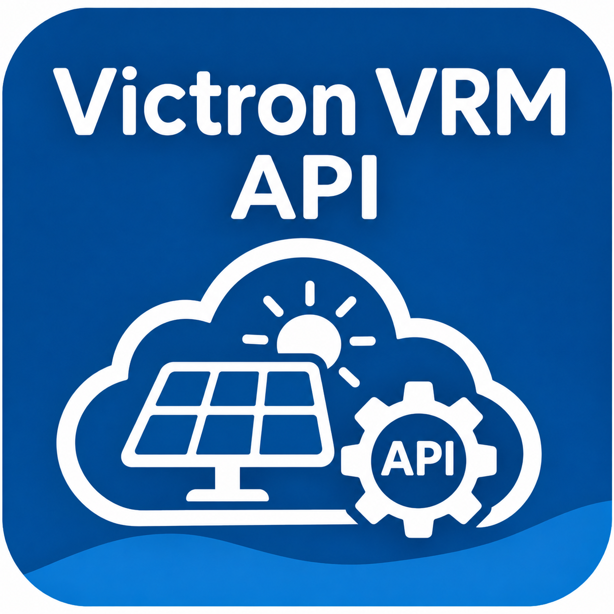

# ioBroker.victron-vrm-api

**Tests:** 
**English** | [Deutsch](docs/de/README.md)

## Victron VRM API adapter for ioBroker

This adapter reads the data of your Victron Energy installations from the cloud API of the
[VRM portal](https://vrm.victronenergy.com). You do not need local access to the GX device (Cerbo GX, Venus GX, …):
everything VRM knows about an installation is available as ioBroker states.

The adapter only reads data. It never changes anything on your installations.

Inspired by the Node-RED node [victron-vrm-api](https://github.com/dirkjanfaber/victron-vrm-api) by Dirk-Jan Faber.

### Features

- Supports several installations per VRM account. You can poll all of them or only the ones you select.
- Provides all diagnostics values that VRM reports, with name, unit and role, one folder per device.
- Lists the devices with product name, firmware and last connection. Folders are named after the devices in VRM
  (custom name, product or model), e.g. "Fronius Symo 5.0-3-M (PV Inverter 20)".
- Provides well-known live values with fixed ids (state of charge, PV, grid, consumption, battery,
  time to go, battery temperature, AC output, generator, EV charger, tank levels).
- Provides energy totals for today, week, month and year: PV yield, consumption, grid import and export,
  battery charged and discharged, self-sufficiency and self-consumption in percent, plus the individual energy
  flows (e.g. PV to battery). One request per installation.
- Provides the PV yield and consumption forecast for today (total and rest of the day) and tomorrow, plus the
  hourly forecast as JSON.
- Provides the alarms from the VRM alarm log: number and list of active alarms, the newest alarm and the last 25
  entries as JSON.
- Lets you exclude devices and values with simple patterns, and cleans up obsolete objects on request.
- Optionally adds sums over L1–L3 for power, current and energy values.
- Uses the time at which VRM logged each value as the state timestamp, so history adapters (History, InfluxDB,
  SQL) store the real point in time, not the time of the poll.
- Shows whether the data in VRM is still fresh (`info.dataStale`) and marks the values of an installation that
  sends no new data with the quality "device not connected".
- Shows ioBroker notifications in admin when VRM rejects the access token, a new alarm becomes active or an
  installation goes offline. The notification-manager adapter can forward them, e.g. to Telegram or e-mail.
- Answers read-only VRM requests from scripts (`sendTo`), see the [reference](docs/en/reference.md#requests-from-scripts).
- Sends requests one after another, honours the VRM rate limit (HTTP 429) and backs off when errors occur.

## Requirements

- Node.js 22 or newer
- js-controller 6.0.11 or newer, admin 7.0.23 or newer
- A VRM account with access to the installations and an access token

## Configuration

1. Create an access token in VRM: **Preferences → Integrations → Access tokens**.
2. Open the instance settings and enter the token on the **Connection** tab.
3. Choose your installations. The list is loaded by the running instance, so save the token first if it stays empty.
   Leave the selection empty to poll all installations of the account.

For all options, see the [reference](docs/en/reference.md#settings).

> **How fresh is the data?** The GX device sends its data to VRM at its *log interval*. The default is 15 minutes.
> Polling faster than that brings no new values. For near-live data, set
> **Settings → VRM online portal → Log interval** on the GX device to 1 minute.

## Documentation

- [Reference](docs/en/reference.md): all settings, the states created by the adapter, live values, energy
  statistics, forecast, alarms, phase sums, excluding devices and values, deleting obsolete objects and requests
  from scripts (`sendTo`)
- [Development](docs/development.md): build, tests, dev-server and its patches

## Disclaimer

Victron Energy and VRM are trademarks of Victron Energy B.V. This project is not affiliated with, endorsed by
or supported by Victron Energy. It uses the public VRM API.

## Changelog
<!--
    Placeholder for the next version (at the beginning of the line):
    ### **WORK IN PROGRESS**
-->
### 0.2.0 (2026-11-16)
* (IggePop) option to delete obsolete objects (deselected installations, removed devices, disabled options)
* (IggePop) exclusion list for devices and diagnostics values
* (IggePop) no phase sums for setpoints and limits (e.g. Hub4 power setpoint, Max Feedin Power)
* (IggePop) sendTo "get" for own read-only VRM requests from scripts
* (IggePop) button "Test connection" in the instance settings
* (IggePop) ioBroker notification when VRM rejects the access token
* (IggePop) values of an installation without new data (info.dataStale) get the quality 0x42 "device not connected"
* (IggePop) self-sufficiency and self-consumption per period (energy.*.autarky, energy.*.selfConsumption)
* (IggePop) remaining battery runtime (live.batteryTimeToGo)
* (IggePop) more live values: battery temperature, AC output, generator, EV charger power and tank levels
* (IggePop) fix: with several battery monitors and no system values, live.soc and the other battery values were added up
* (IggePop) ioBroker notifications for new alarms and when an installation goes offline

### 0.1.0 (2026-11-02)
* (IggePop) initial release
* (IggePop) diagnostics of all installations of a VRM account with well-known live values
* (IggePop) device list with product name and firmware, VRM device names as folder names
* (IggePop) energy statistics for today, week, month and year
* (IggePop) solar yield and consumption forecast
* (IggePop) alarms from the VRM alarm log
* (IggePop) optional sums over L1-L3, VRM timestamps as state timestamps

## License
MIT License

Copyright (c) 2026 IggePop <mail@igge.org>

Permission is hereby granted, free of charge, to any person obtaining a copy
of this software and associated documentation files (the "Software"), to deal
in the Software without restriction, including without limitation the rights
to use, copy, modify, merge, publish, distribute, sublicense, and/or sell
copies of the Software, and to permit persons to whom the Software is
furnished to do so, subject to the following conditions:

The above copyright notice and this permission notice shall be included in all
copies or substantial portions of the Software.

THE SOFTWARE IS PROVIDED "AS IS", WITHOUT WARRANTY OF ANY KIND, EXPRESS OR
IMPLIED, INCLUDING BUT NOT LIMITED TO THE WARRANTIES OF MERCHANTABILITY,
FITNESS FOR A PARTICULAR PURPOSE AND NONINFRINGEMENT. IN NO EVENT SHALL THE
AUTHORS OR COPYRIGHT HOLDERS BE LIABLE FOR ANY CLAIM, DAMAGES OR OTHER
LIABILITY, WHETHER IN AN ACTION OF CONTRACT, TORT OR OTHERWISE, ARISING FROM,
OUT OF OR IN CONNECTION WITH THE SOFTWARE OR THE USE OR OTHER DEALINGS IN THE
SOFTWARE.