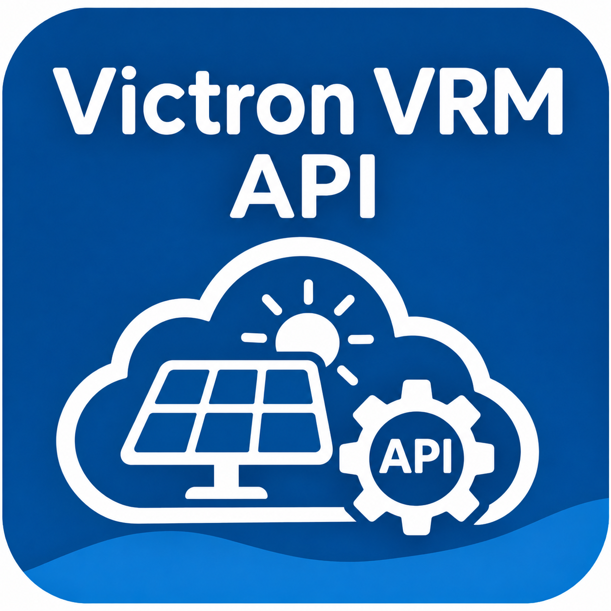

# ioBroker.victron-vrm-api

[English](../../README.md) | **Deutsch**

## Victron-VRM-API-Adapter für ioBroker

Dieser Adapter liest die Daten deiner Victron-Energy-Anlagen über die Cloud-API des
[VRM-Portals](https://vrm.victronenergy.com). Ein lokaler Zugriff auf das GX-Gerät (Cerbo GX, Venus GX, …) ist nicht
nötig: Alles, was VRM über eine Anlage weiß, steht als ioBroker-Datenpunkte zur Verfügung.

Der Adapter liest nur. Er ändert nie etwas an deinen Anlagen.

Inspiriert vom Node-RED-Node [victron-vrm-api](https://github.com/dirkjanfaber/victron-vrm-api) von Dirk-Jan Faber.

### Funktionen

- Unterstützt mehrere Anlagen pro VRM-Konto. Es können alle oder nur ausgewählte Anlagen abgefragt werden.
- Stellt alle Diagnosewerte bereit, die VRM meldet, mit Name, Einheit und Rolle, ein Ordner pro Gerät.
- Listet die Geräte mit Produktname, Firmware und letzter Verbindung. Die Ordner tragen die Namen der Geräte in VRM
  (eigener Name, Produkt oder Modell), z. B. „Fronius Symo 5.0-3-M (PV Inverter 20)“.
- Stellt bekannte Live-Werte unter festen IDs bereit (Ladezustand, PV, Netz, Verbrauch, Batterie).
- Stellt Energiesummen für heute, Woche, Monat und Jahr bereit: PV-Ertrag, Verbrauch, Netzbezug und -einspeisung,
  Batterie geladen und entladen, dazu die einzelnen Energieflüsse (z. B. PV in die Batterie). Eine Anfrage pro
  Anlage.
- Stellt die Prognose für PV-Ertrag und Verbrauch für heute (gesamt und Rest des Tages) und morgen bereit, dazu den
  stündlichen Verlauf als JSON.
- Stellt die Alarme aus dem VRM-Alarmprotokoll bereit: Anzahl und Liste der aktiven Alarme, den neuesten Alarm und
  die letzten 25 Einträge als JSON.
- Geräte und Werte lassen sich mit einfachen Mustern ausschließen, veraltete Objekte werden auf Wunsch aufgeräumt.
- Bildet optional Summen über L1–L3 für Leistung, Strom und Energie.
- Verwendet den Zeitpunkt, zu dem VRM einen Wert protokolliert hat, als Zeitstempel des Datenpunkts. So speichern
  History-Adapter (History, InfluxDB, SQL) den tatsächlichen Zeitpunkt und nicht den der Abfrage.
- Zeigt an, ob die Daten in VRM noch aktuell sind (`info.dataStale`).
- Zeigt im Admin eine ioBroker-Benachrichtigung, wenn VRM das Zugriffstoken ablehnt. Der Adapter
  notification-manager kann sie weiterleiten, z. B. an Telegram oder per E-Mail.
- Beantwortet lesende VRM-Anfragen aus Skripten (`sendTo`), siehe
  [Referenz](reference.md#anfragen-aus-skripten).
- Sendet die Anfragen nacheinander, beachtet das Rate-Limit von VRM (HTTP 429) und wartet bei Fehlern länger.

## Voraussetzungen

- Node.js 22 oder neuer
- js-controller 6.0.11 oder neuer, Admin 7.0.23 oder neuer
- Ein VRM-Konto mit Zugriff auf die Anlagen und ein Zugriffstoken

## Konfiguration

1. In VRM ein Zugriffstoken erstellen: **Einstellungen → Integrationen → Zugriffstoken**.
2. Die Instanzeinstellungen öffnen und das Token im Reiter **Verbindung** eintragen.
3. Die Anlagen auswählen. Die Liste wird über die laufende Instanz geladen. Bleibt sie leer, zuerst das Token
   speichern. Ohne Auswahl werden alle Anlagen des Kontos abgefragt.

Alle Optionen stehen in der [Referenz](reference.md#einstellungen).

> **Wie aktuell sind die Daten?** Das GX-Gerät sendet seine Daten im Takt seines *Log-Intervalls* an VRM.
> Voreingestellt sind 15 Minuten. Häufigeres Abfragen bringt keine neuen Werte. Für nahezu Live-Daten am GX-Gerät
> **Einstellungen → VRM-Online-Portal → Log-Intervall** auf 1 Minute stellen.

## Dokumentation

- [Referenz](reference.md): alle Einstellungen, die vom Adapter angelegten Datenpunkte, Live-Werte,
  Energiestatistik, Prognose, Alarme, Phasensummen, Geräte und Werte ausschließen, veraltete Objekte löschen und
  Anfragen aus Skripten (`sendTo`)
- [Entwicklung](development.md): Build, Tests, dev-server und seine Patches

## Geplant

- Dynamic ESS (nur lesend)

## Hinweis

Victron Energy und VRM sind Marken der Victron Energy B.V. Dieses Projekt steht in keiner Verbindung zu Victron
Energy und wird von Victron Energy weder unterstützt noch gefördert. Es verwendet die öffentliche VRM-API.

Den Changelog gibt es im [englischen README](../../README.md#changelog).
